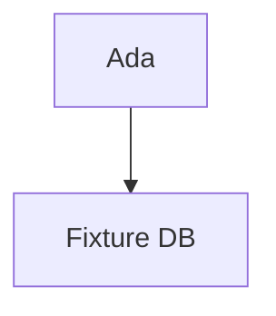

# Ada Fixture

## Summary

Ada Fixture is a synthetic person used by the rw-p1a-render parity fixtures. She maintains [[content/tool/tool-fixture-db|Fixture DB]] and is cited by #[[content/thought/9001|9001]] and [[content/source/00000000-0000-4000-8000-000000000001|S1]].

## Key Facts

- Prefers ==highlighted text== for emphasis.
- Works with [[content/person/person-bob-fixture|Bob Fixture]] on the fixture notebook.
- Mass–energy: $E = mc^2$ inline, and a block:

$$
\int_0^1 x^2 \, dx = \frac{1}{3}
$$

> [!note] A fixture callout
> Callouts are an Obsidian transform the renderer must port.

> [!warning]- Collapsed warning
> This callout starts folded.

| Year | Event |
| ---- | ----- |
| 2025 | Joined the fixture project |
| 2026 | Shipped the parity renderer |

- [x] a done task
- [ ] an open task

```js
const answer = 42;
console.log(answer);
```



A footnote reference.[^1]

%% an Obsidian comment that must not render %%

<script>alert("raw html must be dropped")</script>

### depends_on

- [[content/tool/tool-fixture-db|Fixture DB]] (3)

## Open Questions

- What links to the retired topic [[content/topic/fixture-retired-topic|Retired Topic]]?

[^1]: The footnote text.

## Evolution

- **2026-10-01** — First captured as a thought-based mental model (ungrounded belief).
- **2026-10-02** — Grounded by [[content/source/00000000-0000-4000-8000-000000000001|Fixture Article]] (web_article).
