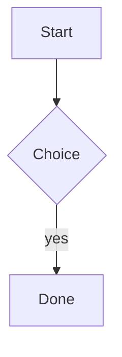

# Kitchen Sink Fixture

A footnote here[^one] and another[^two]. Inline math $e^{i\pi} + 1 = 0$ and ==highlighted text==.

$$
\int_0^1 x^2 \, dx = \frac{1}{3}
$$

> [!note] A note callout
> With **bold** and a [[fixture-note]] link.

> [!warning]- Folded warning
> Hidden content with $a^2+b^2=c^2$.
>
> > [!tip] Nested tip
> > Inner text[^one].

| col a | col b |
| ----- | :---: |
| 1     | $x$   |

## Second heading

- [ ] a task
- [x] a done task

See [[kitchen-sink#Second heading|the second heading]] and ![[fixture-note]].

[^one]: The first footnote, with `code`.
[^two]: The second footnote, with a [link](https://example.org).
